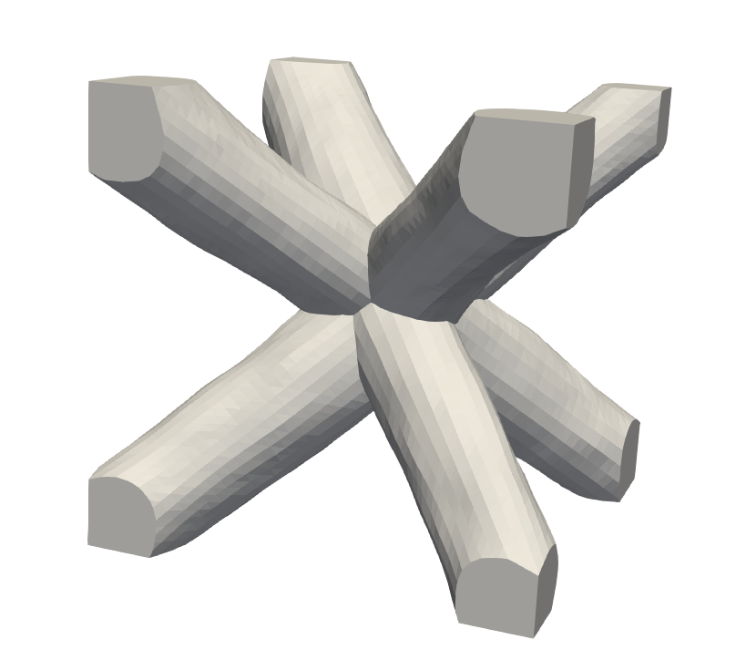

# pyLattice ↔︎ Pyrough compatibility
Combining the design capabilities of **pyLatticeDSO** with the surface roughness control provided by **Pyrough** 
enables the generation of truss lattice structures with rough beam surfaces.
This integration allows users to investigate the influence of surface roughness on the mechanical behavior of lattice structures, which is of major interest for applications in additive manufacturing and materials science.

---
## Installation
To use **pyLatticeDSO** with **Pyrough**, install pyLatticeDSO as a submodule inside your Pyrough repository:

```bash
git submodule add https://github.com/jamodeo12/Pyrough.git Pyrough/
```
Additional dependencies are required to handle the increased mesh complexity of lattice structures.
From the Pyrough root directory, run:
```bash
pip install trimesh manifold3d
```

## Usage
To generate a rough lattice structure, two input files are required:
1. A lattice geometry definition file created for **pyLatticeDSO**
2. A roughness parameter file processed by **Pyrough**

Sample files are provided in:
- `examples/BCC_cell.json` (lattice geometry)
- `examples/lattice_wire.json` (roughness configuration)
From the Pyrough root directory, run:
```bash
python Pyrough.py .\examples\lattice_wire.json
```
This command generates a rough lattice structure using the lattice geometry defined in `BCC_cell.json` and applies the surface roughness parameters specified in `lattice_wire.json`.
The image below illustrates a BCC lattice structure with rough beam surfaces generated using this approach:


See the [Pyrough documentation](https://jamodeo12.github.io/Pyrough/) for more details on configuring roughness parameters and additional functionalities.

---
## Influence of the roughness on the mechanical response
The example `examples/Pyrough/BCC_rough_compression.py` quantifies the effect of the roughness on a BCC cell with a
virtual compression test (3D solid model, bonded rigid platens, linear elasticity):

1. Pyrough generates the rough lattice (`Lattice.generate_mesh_lattice_rough`) for several RMS roughness amplitudes
   and several random realizations, and the smooth references with a zero RMS (same meshing pipeline);
2. the surface mesh is cut by the flat bounding box, cleaned and meshed with tetrahedra
   (`SolidModel(..., surface_mesh_file=...)`);
3. the apparent modulus, the relative density and the stress concentrations are compared with smooth samples at the
   same nominal radius and at the same relative density (radius sweep).

Requirements: the `pyLattice_comp_V2` branch of Pyrough, whose root folder is given by the environment variable
`PYROUGH_PATH`, and `pip install manifold3d pymeshlab trimesh networkx wulffpack ase meshio`.
```bash
PYROUGH_PATH=/path/to/Pyrough python examples/Pyrough/BCC_rough_compression.py
```
